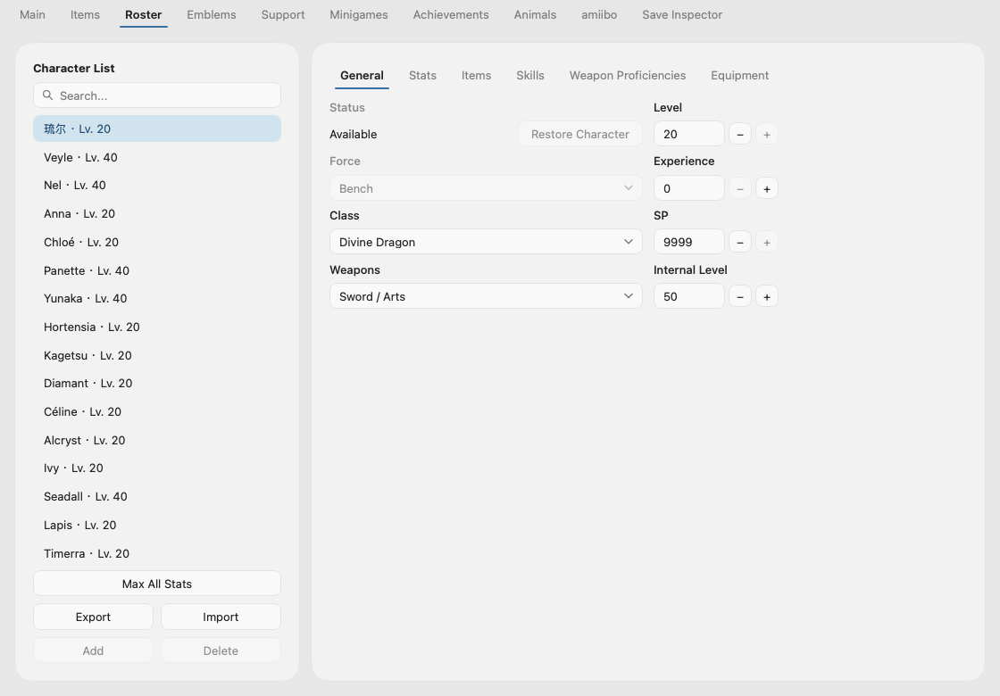

# FEE Save Editor

Edit Fire Emblem Engage saves, including DLC characters, Emblems and Bond Rings.

## Features

- **Animals:** Browse all 24 adoptable species with localized names. Edit one species' owned count, maximize it to 99, or maximize every species together. Current grazing selections are preserved.
- **Relay Tickets:** Open `Global` to edit the ticket count for a registered campaign, up to 999. Campaigns stay separate; daily counters, timestamps and online progress are preserved.
- **Main:** Separate cards for game settings, resources, Somniel activities and donations. Edit the protagonist's name, play time in hours/minutes/seconds, money, bond fragments, iron/steel/silver ingots, difficulty, game mode and Sommie's name. Edit or restore remaining strength-training and standard Arena uses without changing scores. All four countries are shown together in the Donations card, with linked level and donated amount fields and one button to maximize all countries.
- **Minigames:** Separate cards for push-ups, sit-ups, squats, wyvern riding and fishing, with all records directly visible. Edit training high scores for every difficulty, wyvern scores and saved evaluations, and each fish's catch count, best size and size rank. Cards grow with their contents; only the whole page scrolls.
- **Items:** Switch directly between Convoy, Reclass Items, Materials, Ingredients, Gifts and Key Items tabs. Search the convoy, add, replace or delete items, edit remaining uses and weapon refinement, and restore uses to each item's normal maximum. Assign or clear any of the 20 base-game/DLC Emblem engravings and preview their effects. Assigning an engraving transfers it from its previous weapon, including weapons held by a character. Browse 105 quantity-based items, including Master/Second Seals, DLC Mystic Satchels and Mage Cannons, ingredients, gifts, crystals and key items. Edit their saved counts within the game's limits, or fill all reclass items, materials, ingredients or gifts to their individual maximums. Ingot counts stay linked to Main.
- **Roster:** Edit character level, experience, SP, internal level and current HP. Restore dead or lost playable characters, move inactive characters between bench, dead and lost pools, and add missing base-game/DLC characters at level 1 in their starting class without advancing recruitment events. Delete unlinked non-protagonist characters after clearing their ordinary carried items; equipped rings are returned first. Missing or unknown classes on inactive playable characters are repaired on opening. Edit personal stats with a live preview of current-class stats and caps, or maximize one character or the whole roster across available classes. Change classes using character, gender and weapon-branch restrictions, including exclusive and DLC classes. Manage carried items, engravings, inherited/equipped skills, class skills and weapon proficiencies. Equip, transfer or unequip owned Emblems and Bond Rings. Export character edits and import them into the same character in another compatible save.
- **Emblems:** Switch between Bonds and Bond Rings tabs. Add or remove normal base-game Emblems and DLC Bracelets while retaining existing bond progress; removal first unequips the ring and excludes story-reserved or Engage+ equipment. Edit character bond levels and linked experience, or maximize one or all character bonds for the selected Emblem. Edit dirtiness, clean the selected Emblem Ring or Bracelet, or clean all owned rings and bracelets. Manage Bond Ring quantities within the shared 99-copy limit, preview stat bonuses and S-rank skills, fill missing S-rank rings, and meld unequipped duplicates using the game's ring and bond-fragment costs. Equipped copies are not consumed.
- **Support:** Search character pairs, edit their support rank and linked points, or maximize one or every existing pair. Rank choices follow each pair's thresholds; an existing Pact partner is preserved.
- **Achievements:** Browse 765 named achievements by category, completion status or search. Check whether an achievement is unfulfilled, has an available reward or has already been claimed. Unlock one or all achievements without resetting claimed rewards or changing bond fragments, activity counters or story progress.
- **amiibo:** Browse 12 outfits and 12 music tracks in separate cards with official localized names and unlocked counts. Unlock selected rewards or a complete group without changing tickets, scanning history or story progress.
- **Inspector:** Look up save-file information, search its sections, or browse and edit existing numeric game variables from the final navigation tab. String variables and unknown formats remain untouched.

Open **Help → About** to view the application version and visit its GitHub repository.

The initial language follows your system preferences. The Language menu also supports Simplified Chinese, Traditional Chinese, Japanese, Korean, German, French, Spanish and Italian. Interface text and game-data names switch together, including characters, classes, skills, items, rings and achievements. Light and dark appearance follow your system settings.

## Get started

Download the GUI from the [latest release](https://github.com/jinghaihan/fee-save-editor/releases/latest).

Open a `Manual0` or `Auto` save, make your edits, then save a copy to another folder. Keep the original until you have checked the edited copy in-game. Open `Global` separately for Relay Tickets; editing a game save does not silently change its companion `Global` file.

For scripted edits, see the [CLI guide](CLI.md).

## Credits

- [egoist/MyGo](https://github.com/egoist/mygo): desktop interface.
- [Xzonn/FireEmblemEngageData](https://github.com/Xzonn/FireEmblemEngageData): game-data tables used to build the catalogs.
- [delvier/Iron19_L10n](https://github.com/delvier/Iron19_L10n): Localized game text in all nine supported languages.
- [laqieer/FE17-DOC](https://github.com/laqieer/FE17-DOC) and [LordMewtwo73/feEngage-randomizer](https://github.com/LordMewtwo73/feEngage-randomizer): save-format references and item, character, class and skill data.

## License

[MIT](./LICENSE) License © [jinghaihan](https://github.com/jinghaihan)
